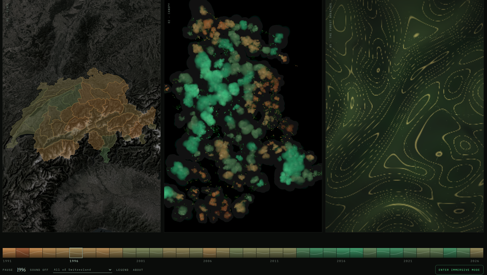
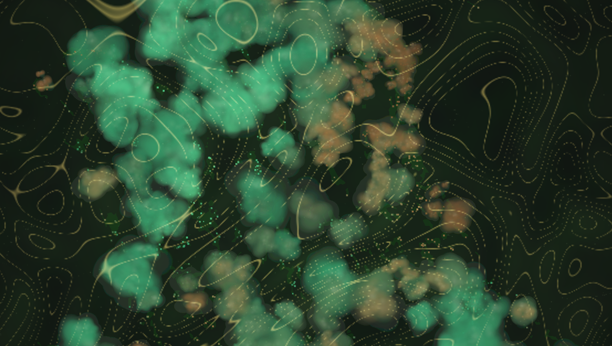
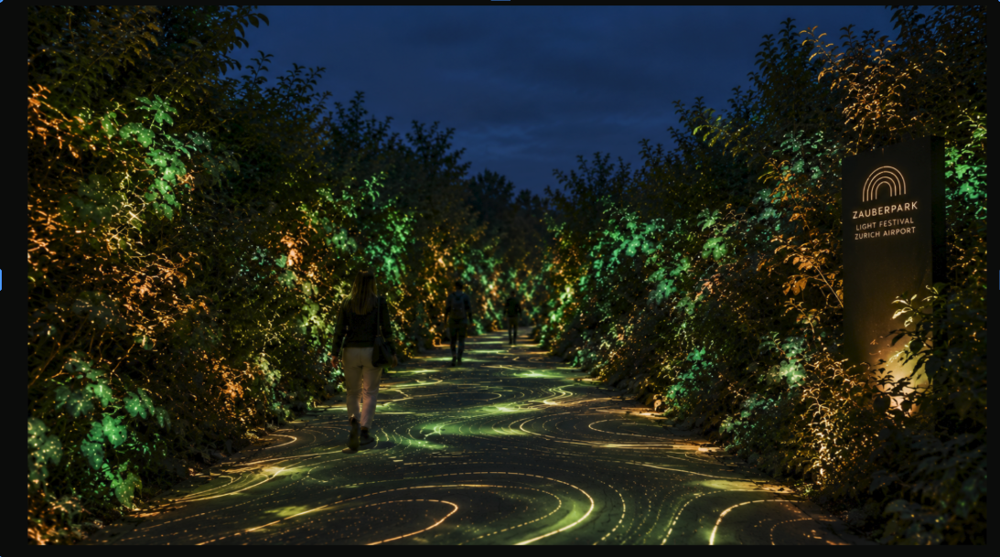
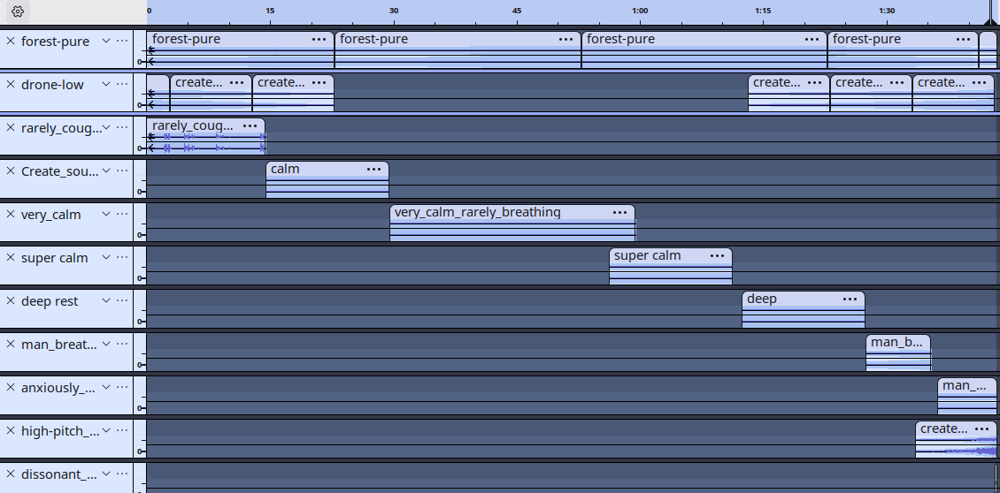

# The Forest's Breath

*A Somatic Archive of Swiss Forest Resilience (1991–2026)*

**Live site → [the-forest-s-breath.lovable.app](https://the-forest-s-breath.lovable.app)**

Every minute, a human body breathes between twelve and sixteen times. In sickness or fever, our breath turns rapid, shallow, and strained. In health, it eases into an expansive, calming rhythm. We share this biology with the forest — yet when climate distress strikes, the data that tracks it stays buried in spreadsheets and technical reports.


**The Forest's Breath** translates 36 years of Swiss satellite observations into a living, sensory experience, letting you feel ecological health and distress through **sound, colour, and movement**.

## The visualisation

The installation runs as three synchronized panels:

- **Place — the map.** A cartography of Switzerland drawn from swisstopo basemaps, with the 38 official vegetation-health regions outlined and shaded by their annual condition. Selecting a region reframes the map and retunes the other two panels to that place.
- **Time — the Canopy.** An algorithmic grove whose crowns widen and deepen into green as vegetation recovers, and shrink and burn into ochre and copper-rust as drought takes hold. Growth is computed from the index, not drawn by hand.
- **Breathing — the landscape.** A generative field of topographic contours driven by domain-warped noise. Its tempo is the artwork's pulse: severe drought makes the respiration frantic, rapid and shallow, while recovery slows it into a deep, meditative rhythm.

**Immersion Mode** folds the three panels into a single full-screen field over pure black, switches the data to the national average, and layers the Canopy above the breathing landscape. A resolution toggle keeps it running on slower machines.

An original 108-second score is locked directly to the timeline — three seconds per year — so sound, colour and movement advance together from 1991 to 2026.

## In pictures

The three-panel interface, with the chronological timeline running along the bottom:



Immersion Mode, where the panels fold into one full-screen field:



A concept mockup for showing the piece as a light installation at a festival:



## The data

Source: **Federal Office for the Environment (FOEN) & swisstopo** — swissEO Vegetation Health Index (VHI), 1991–2026.

The VHI condenses satellite observations of vegetation into a single figure: how green and vigorous the canopy is, and how much heat and water stress it is under. High values mean healthy, well-watered vegetation; low values mean stressed plants and drought.

The raw feed is monthly, so the project builds the series the artwork plays on:

- 16,340 monthly observations across **38 regions**, January 1991 to October 2026.
- Each region's **annual value is the mean of all its available months** — a full-calendar-year picture rather than a single dated snapshot.
- 1,034 months arrive empty; 1,024 of them are filled by **linear interpolation between the neighbouring months of the same region** (the remainder sit at the start or end of a region's series and are left as gaps). Nothing is extrapolated beyond the observed range.
- The **national view is the equal-weight mean across all regions** present in a given year, so one well-sampled region cannot dominate the country's pulse.
- Visuals are calibrated to the record itself: the worst year in the dataset reads as maximum drought, the best as peak vitality.
- 2026 is **preliminary** (January–October).

Key moments to explore: **1992** (vegetation stress), **2017** (peak vitality), and **2025–2026** (emerging climate pressure).

## The sound

The score is assembled by hand from breath samples synthesised with ElevenLabs. Each fragment is carefully glued into the next and then level-matched, so the loudness stays even across the whole 108 seconds. Underneath the breath sits a bed of forest sounds and a low-frequency drone that quietly increases anxiety as the index drops; in the final stretch a squeaky violin tremolo takes over, leaving the tension hanging in the room.



## The team


*The Forest's Breath* was created at the intersection of four disciplines:

| Name | Role | Contribution |
| --- | --- | --- |
| **Silvia Forcina Barrero** | Statistics & Computational Systems | Data architecture, algorithmic evolution, and engineering of visual and acoustic systems, with project coordination. |
| **Manuela Pita Vidal** | Artistic Direction & Curation | Exhibition concept, artistic direction, visual identity, and website design, including AI-assisted audiovisual production, visual archive curation, and creation of the presentation slides. · [@pitart__](https://www.instagram.com/pitart__/) |
| **Anton Maksimov** | Sound Design & Composition | Synthesis of breath fragments via ElevenLabs and custom data-driven sound design, with refinement of the visual components and set-up of the tools. |
| **Tamari Karkhnishvili** | Data Analytics in the Humanities | Canopy algorithmic evolution, interactive real-time visuals, and creation of the presentation slides. |

## Links

- Repository: [github.com/antmaxi/art-tech-hack-visual](https://github.com/antmaxi/art-tech-hack-visual)
- Data source: [swissEO VHI — Vegetation Health Index (swisstopo)](https://opendata.swiss/en/dataset/swisseo-vhi-karte-des-vhi), layer `ch.swisstopo.swisseo_vhi_v100`

---

This project was built with [Lovable](https://lovable.dev).

## Build with Lovable

Continue developing this project in the [Lovable editor](https://lovable.dev/projects/aa6790bc-e5e4-446e-a0d2-2ef63d4aae31).

- **Ship faster**: describe what you want to build and Lovable handles the code.
- **Stay in sync**: every change made in Lovable is committed straight to this repository.
- **Full ownership**: this code is yours. Push to `main` on GitHub and your changes sync back into Lovable, ready for your next prompt.

## Development

Prefer working locally? You need Node.js and npm — [install with nvm](https://github.com/nvm-sh/nvm#installing-and-updating).

```sh
git clone <this-repository-url>
cd <repository-name>
npm i
npm run dev
```
